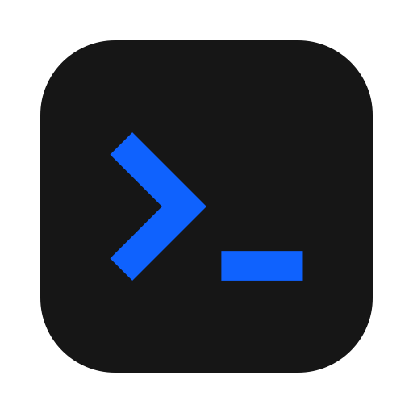
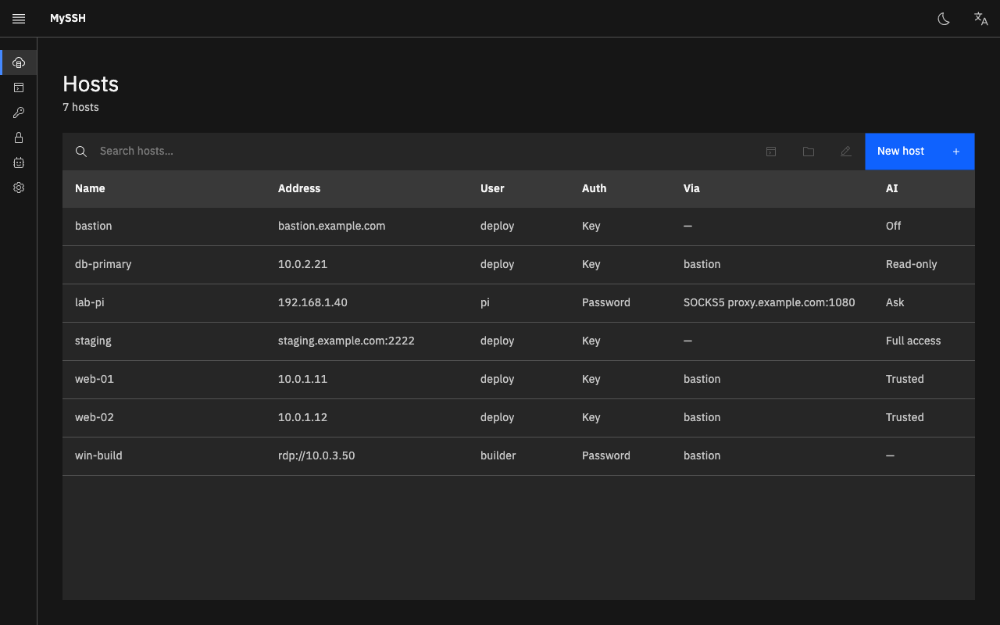
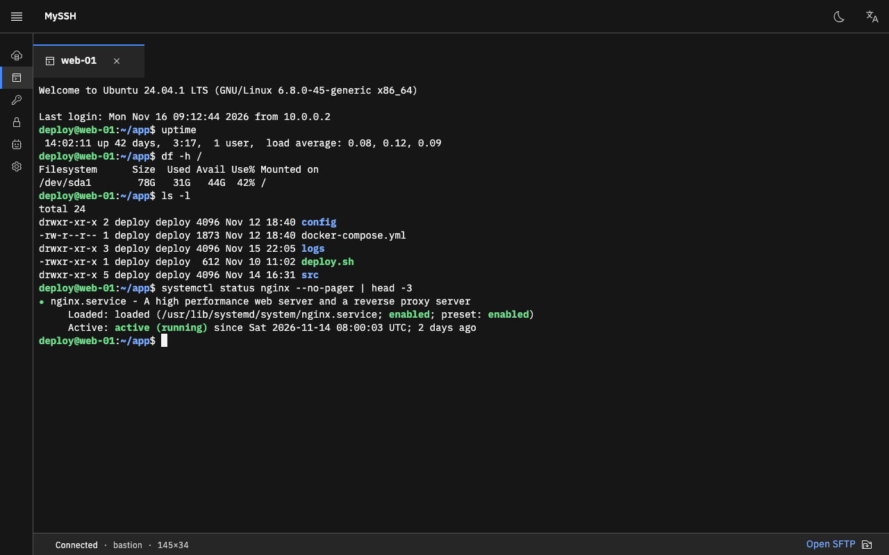
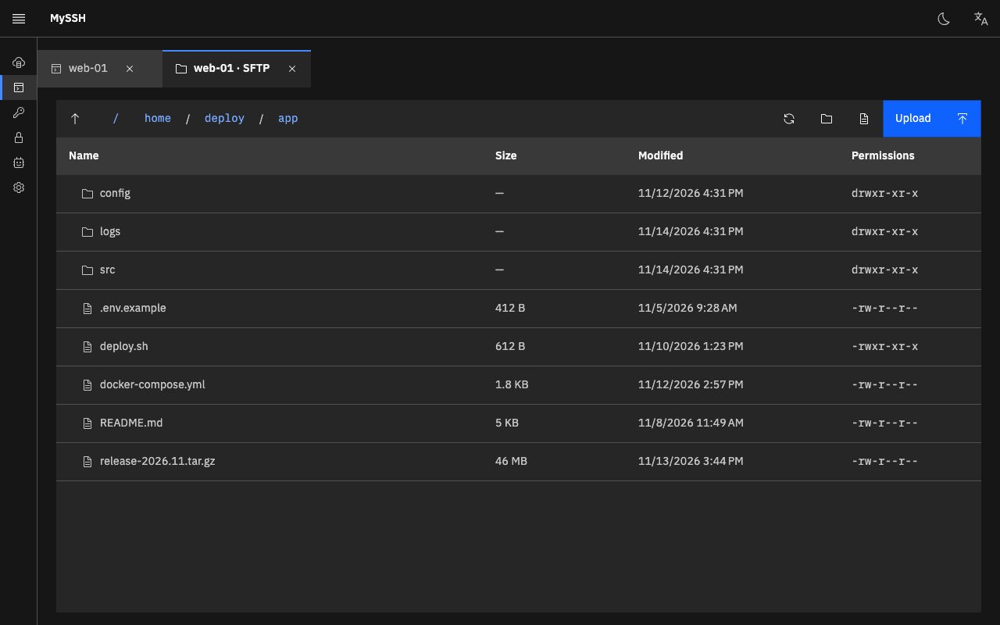
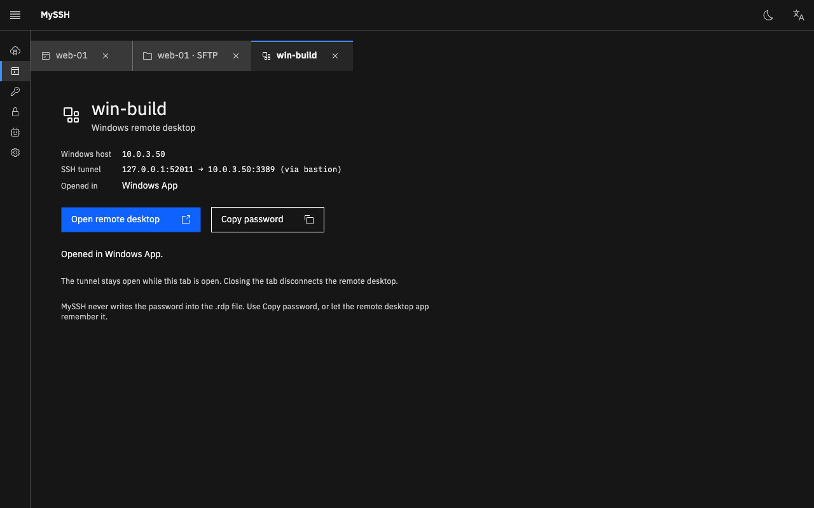
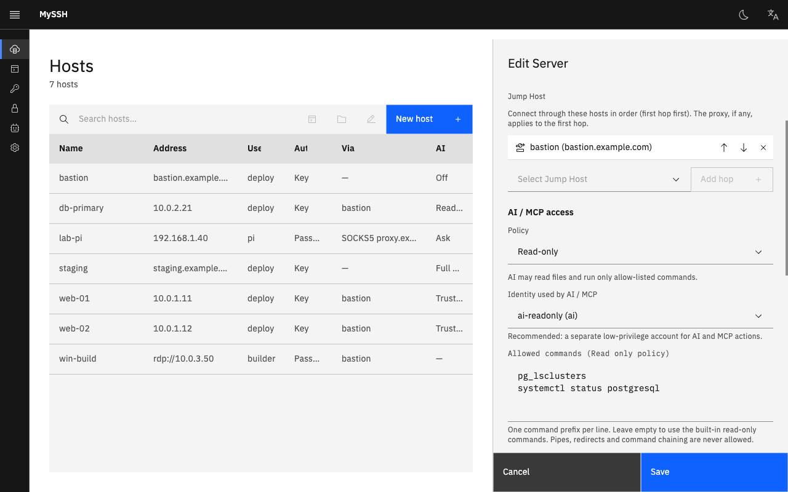
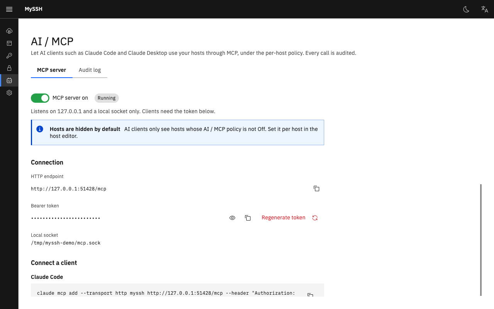
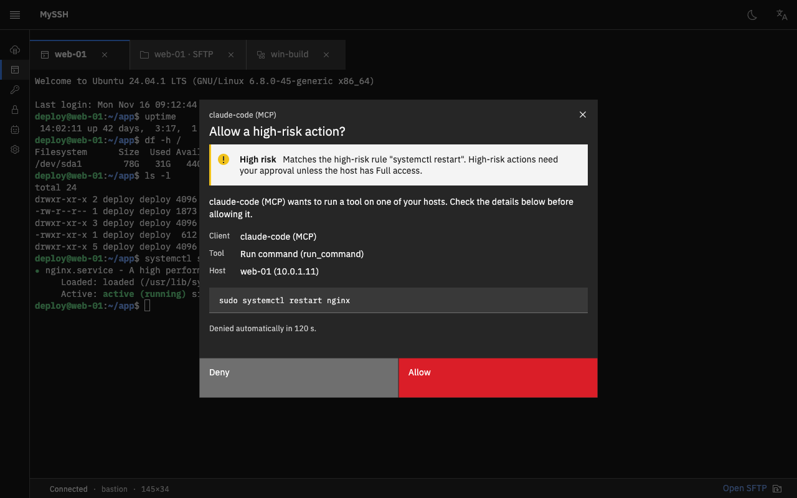

# MySSH

<p align="center">
  
</p>

<p align="center">
  シンプルなオープンソース SSH クライアント - Termius の代替品
</p>

<p align="center">
  <a href="https://myssh.pages.dev/ja/">公式サイト</a> · <a href="https://github.com/dollarkillerx/MySSH/releases/latest">ダウンロード</a>
</p>

<p align="center">
  <a href="./README.md">English</a> | <a href="./README.zh-CN.md">简体中文</a> | <strong>日本語</strong>
</p>

## 機能

- **ホスト管理** - ホスト、再利用できる認証情報（パスワード / 秘密鍵）、プロキシ、タグ、検索
- **SSH ターミナル** - ネイティブターミナル（XTerm.NET エンジン）、256 色 / トゥルーカラー、OSC 7 の作業ディレクトリ
- **SFTP ファイルブラウザ** - リモートファイルの閲覧、アップロード、ダウンロード、編集。ターミナルの **SFTP を開く** で現在のディレクトリを開きます
- **踏み台ホスト** - 多段接続（ProxyJump）、ホップごとに別の認証情報。HTTP / SOCKS5 プロキシにも対応
- **Windows リモートデスクトップ** - RDP ホストを OS のクライアント（mstsc、Windows App、Remmina / FreeRDP）で開きます。SSH 踏み台経由のトンネルにも対応し、パスワードは `.rdp` ファイルに書き込みません
- **MCP サーバー** - Claude Code、Claude Desktop などの MCP クライアントからホストでコマンド実行、ターミナルの読み取り、SFTP を利用できます
- **AI アシスタント** - 内蔵のチャットパネル（Claude、OpenAI、DeepSeek、ローカルの OpenAI 互換サーバー）。MCP と同じツールとホストごとのポリシーで調査し、承認はチャット内のカードで行います。ターミナルでは Ctrl+I でコマンドを提案。送信前に機密情報を伏せます
- **ホストごとの AI ポリシー** - オフ / 読み取り専用 / 確認 / 信頼 / フルアクセス。高リスクなコマンド（`rm -rf`、`systemctl stop` など）は承認が必要で、すべての呼び出しが監査ログに残ります
- **安全なストレージ** - SQLite + AES-256-GCM のフィールド暗号化。マスターキーは OS のキーストア、または Argon2id マスターパスワードで保護
- **バックアップ** - パスワード保護付きのエクスポート / インポート。旧バージョン（Tauri）からホストをインポート可能
- **多言語対応** - 日本語、英語、中国語（簡体字・繁体字）、韓国語
- **クロスプラットフォーム** - macOS、Windows、Linux

## スクリーンショット

| | |
|---|---|
|  |  |
| ホスト、踏み台、プロキシ、ホストごとの AI ポリシー | ネイティブターミナル |
|  |  |
| ターミナルの現在のディレクトリから開いた SFTP | SSH トンネル経由の Windows リモートデスクトップ |
|  |  |
| ホストごとの踏み台チェーンと AI / MCP アクセス | Claude Code / Claude Desktop 向け MCP サーバー |



<sub>AI クライアントからの高リスクなコマンドは承認待ちになります。スクリーンショットはデモデータです（UI は英語）。再生成：
`MYSSH_README_SCREENSHOTS=1 dotnet test tests/MySSH.Desktop.Tests -- --filter-class MySSH.Desktop.Tests.ReadmeScreenshots`</sub>

## MCP（AI クライアント）

1. **AI / MCP** ページで MCP サーバーをオンにします（`127.0.0.1` とローカルソケットのみで待ち受け、Bearer トークンが必要）。
2. 公開したいホストに **AI / MCP ポリシー** を設定します（設定していないホストは AI から見えません）。
3. クライアントを接続します。**Claude Code** はページの `claude mcp add ...` コマンドを、**Claude Desktop** は JSON 設定をコピーします。後者は同梱の `myssh-mcp` ブリッジを実行し、必要ならトレイで MySSH を起動します。

ツール：`list_hosts`、`run_command`、`list_sessions`、`read_terminal`、`send_to_terminal`、`sftp_list`、`sftp_stat`、`sftp_read`、`sftp_write`、`sftp_mkdir`、`sftp_delete`。すべての呼び出しは監査ログに記録されます。

## インストール

### ダウンロード

[Releases](https://github.com/dollarkillerx/MySSH/releases/latest) または[公式サイト](https://myssh.pages.dev/ja/)からダウンロードできます。

- **macOS**（Apple シリコン、macOS 13 以降）：`MySSH-osx-Portable.zip` を展開し、MySSH.app を「アプリケーション」に移動します。署名・公証済みです。
- **Windows**（x64、Windows 10 以降）：`MySSH-win-Setup.exe` またはポータブル版 `MySSH-win-Portable.zip`。まだコード署名がないため、SmartScreen が表示されたら「詳細情報 → 実行」を選んでください。
- **Linux**：現在はソースからビルドしてください。

インストール後は自動でアップデートされます（設定 → アップデート）。v0.0.4 以前のリリースは旧 Tauri/Vue/Rust 版です（タグ [`tauri-final`](https://github.com/dollarkillerx/MySSH/tree/tauri-final)）。

### ソースからビルド

[.NET SDK 10.0.404+](https://dotnet.microsoft.com/download/dotnet/10.0) が必要です。

```bash
git clone https://github.com/dollarkillerx/MySSH.git
cd MySSH
dotnet build MySSH.slnx
dotnet test MySSH.slnx
dotnet run --project src/MySSH.Desktop
```

初回起動時に旧バージョン（Tauri）からホストをインポートできます。旧ファイルは読み取るだけです。

## 技術スタック

- **UI**：Avalonia 12 + IBM Carbon Design System（MVVM：CommunityToolkit.Mvvm）
- **ターミナル**：XTerm.NET VT エンジン上のネイティブ Avalonia コントロール
- **SSH/SFTP**：SSH.NET
- **ストレージ**：SQLite、AES-256-GCM のフィールド暗号化。マスターキーは OS のキーストア、または Argon2id マスターパスワードで保護
- **連携**：MCP サーバー（ModelContextProtocol C# SDK：Streamable HTTP + ローカルソケット、`myssh-mcp` stdio ブリッジ）、内蔵 AI アシスタント（自前の Claude HTTP/SSE クライアント + OpenAI SDK）

設計ドキュメント：[docs/design/avalonia-carbon-mcp.md](docs/design/avalonia-carbon-mcp.md)

## ライセンス

MySSH はフリーソフトウェアです。GNU Affero 一般公衆利用許諾書 第 3 版、または（任意で）それ以降のバージョン（`AGPL-3.0-or-later`）の条件で配布しています。詳しくは [LICENSE](LICENSE) をご覧ください。

v0.2.3 以前のリリースには、公開時のライセンスが引き続き適用されます。
