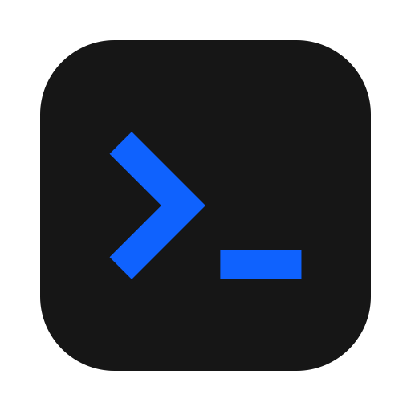
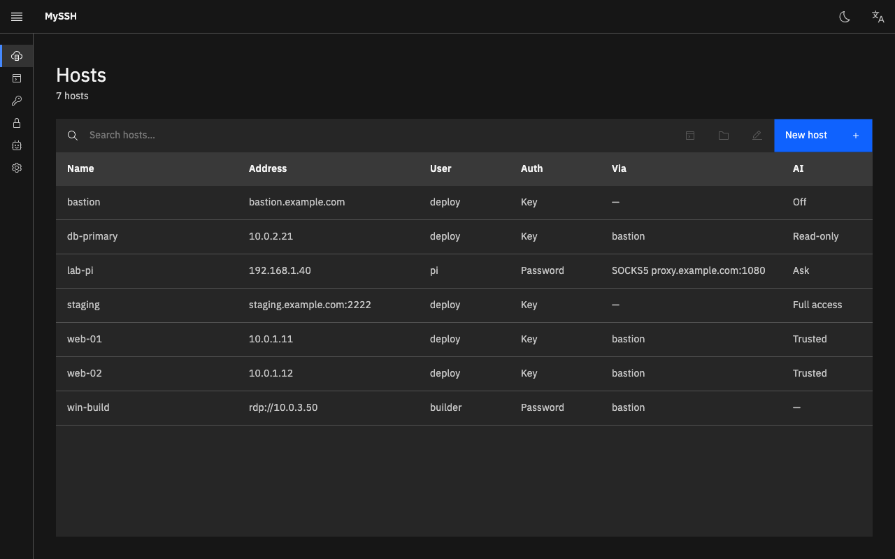
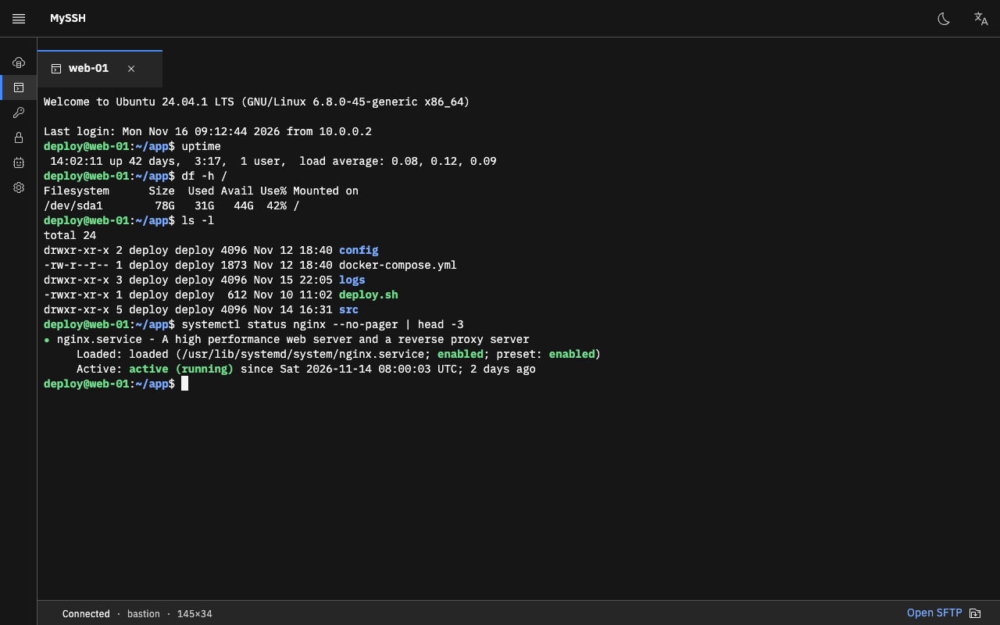
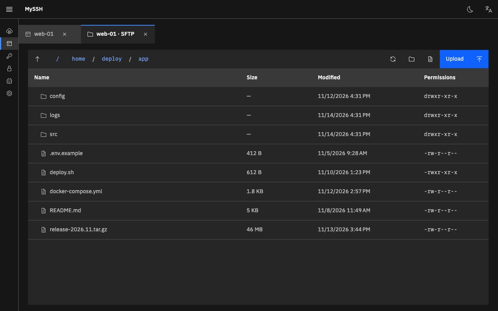
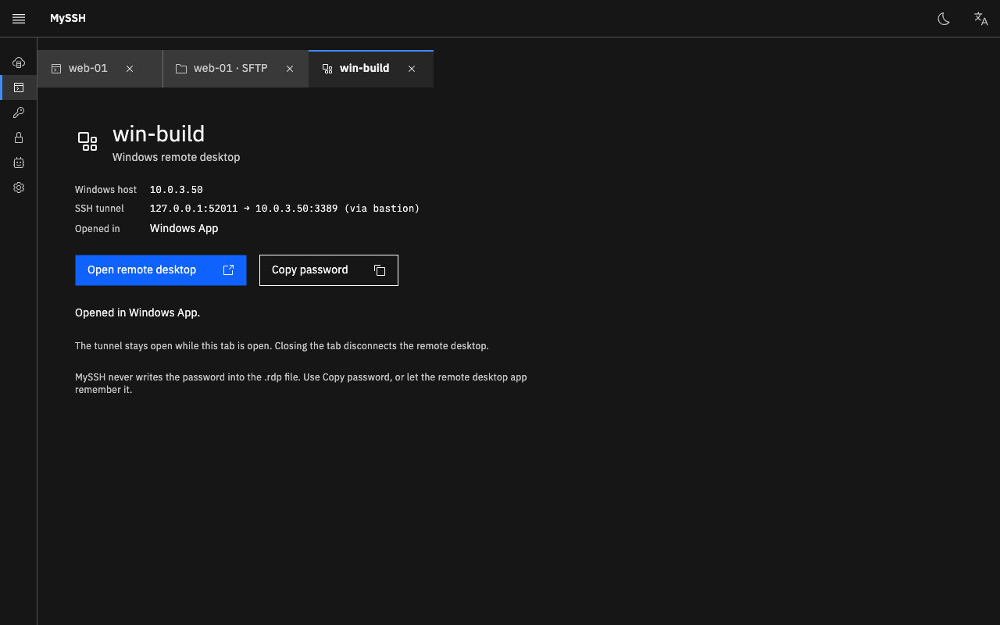
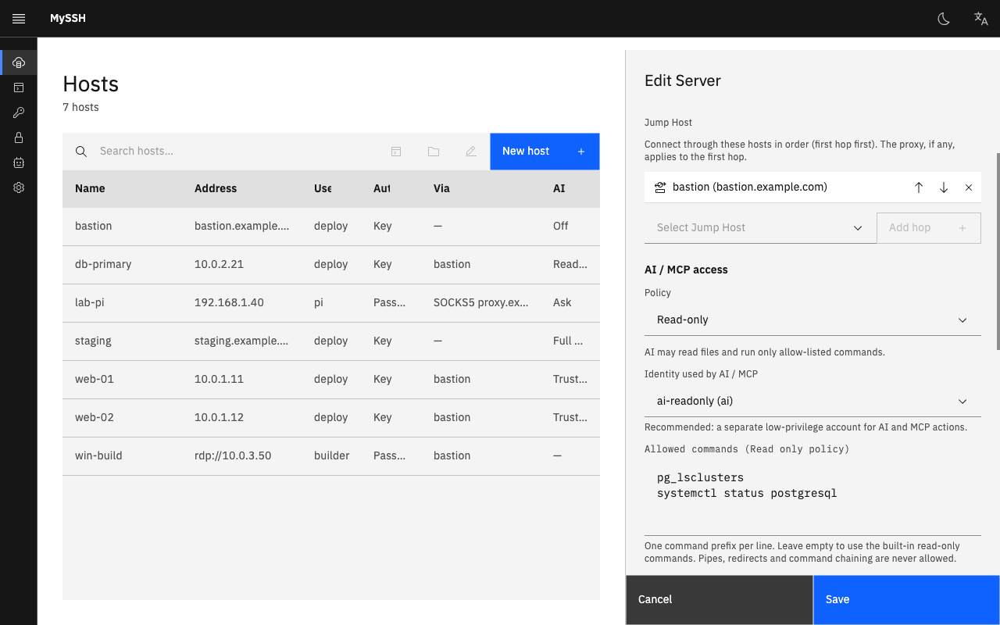
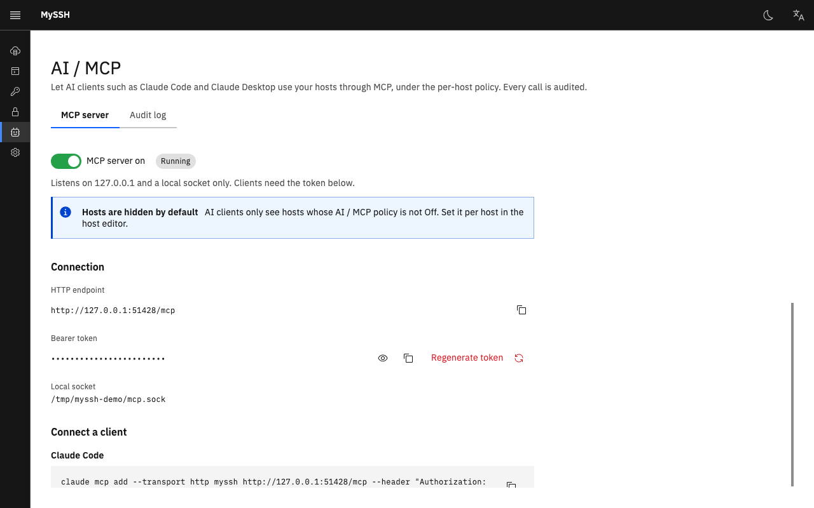
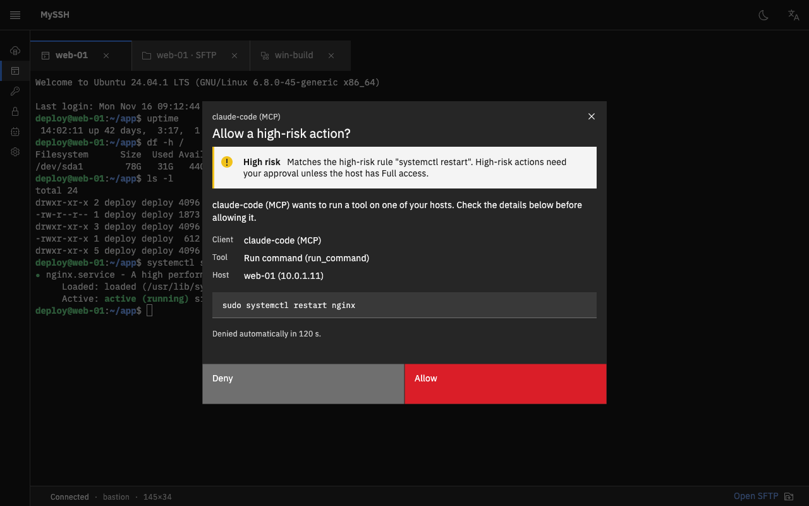

# MySSH

<p align="center">
  
</p>

<p align="center">
  간단한 오픈 소스 SSH 클라이언트 - Termius 대안
</p>

<p align="center">
  <a href="https://myssh.pages.dev/ko/">웹사이트</a> · <a href="https://github.com/dollarkillerx/MySSH/releases/latest">다운로드</a>
</p>

<p align="center">
  <a href="./README.md">English</a> | <a href="./README.zh-CN.md">简体中文</a> | <a href="./README.zh-TW.md">繁體中文</a> | <a href="./README.ja-JP.md">日本語</a> | <strong>한국어</strong>
</p>

## 기능

- **호스트 관리** - 호스트, 재사용 가능한 자격 증명(비밀번호 / 개인 키), 프록시, 태그, 검색
- **SSH 터미널** - 네이티브 터미널(XTerm.NET 엔진), 256색 / 트루컬러, OSC 7 작업 디렉터리 인식
- **SFTP 파일 브라우저** - 원격 파일 탐색, 업로드, 다운로드, 편집. 터미널에서 **SFTP 열기**를 누르면 현재 디렉터리가 바로 열립니다
- **점프 호스트** - 다중 홉 체인(ProxyJump), 홉마다 다른 자격 증명 사용, HTTP / SOCKS5 프록시 지원
- **Windows 원격 데스크톱** - RDP 호스트를 시스템 클라이언트(mstsc, Windows App, Remmina / FreeRDP)로 열며, SSH 점프 호스트를 통한 터널링도 지원합니다. 비밀번호는 `.rdp` 파일에 기록되지 않습니다
- **MCP 서버** - Claude Code, Claude Desktop 등 MCP 클라이언트가 내 호스트에서 명령을 실행하고, 터미널을 읽고, SFTP를 사용할 수 있습니다
- **AI 도우미** - 내장 채팅 패널(Claude, OpenAI, DeepSeek 또는 로컬 OpenAI 호환 서버). MCP와 같은 도구와 호스트별 정책을 사용하고, 승인은 대화 카드에서 바로 처리합니다. 터미널에서 Ctrl+I로 명령을 추천받을 수 있으며, 보내기 전에 비밀 정보를 자동으로 가립니다
- **호스트별 AI 정책** - 끔 / 읽기 전용 / 매번 확인 / 신뢰 / 전체 액세스. 고위험 명령(`rm -rf`, `systemctl stop` 등)은 승인을 받아야 하며, 모든 호출은 감사 로그에 기록됩니다
- **안전한 저장소** - SQLite + AES-256-GCM 필드 암호화. 마스터 키는 OS 키 저장소에 보관하거나 Argon2id 마스터 비밀번호로 보호합니다
- **백업 및 복원** - 비밀번호로 보호되는 내보내기 / 가져오기. 이전 버전(Tauri)의 호스트를 가져올 수 있습니다
- **다국어** - 영어, 중국어(간체·번체), 일본어, 한국어
- **크로스 플랫폼** - macOS, Windows, Linux

## 스크린샷

| | |
|---|---|
|  |  |
| 호스트, 점프 호스트, 프록시와 호스트별 AI 정책 | 네이티브 터미널 |
|  |  |
| 터미널의 현재 디렉터리에서 연 SFTP | SSH 터널을 통한 Windows 원격 데스크톱 |
|  |  |
| 호스트별 점프 체인과 AI / MCP 액세스 | Claude Code / Claude Desktop용 MCP 서버 |



<sub>AI 클라이언트의 고위험 명령은 사용자의 승인을 기다립니다. 스크린샷은 데모 데이터로 만들었으며 다음 명령으로 다시 생성할 수 있습니다:
`MYSSH_README_SCREENSHOTS=1 dotnet test tests/MySSH.Desktop.Tests -- --filter-class MySSH.Desktop.Tests.ReadmeScreenshots`.</sub>

## MCP (AI 클라이언트)

1. **AI / MCP**를 열고 MCP 서버를 켭니다. `127.0.0.1`과 로컬 소켓에서만 수신하며, Bearer 토큰으로 보호됩니다.
2. 공유하려는 호스트마다 **AI / MCP 정책**을 설정합니다(설정하기 전까지 호스트는 AI에 보이지 않습니다).
3. 클라이언트를 연결합니다:
   - **Claude Code**: 페이지에 표시된 `claude mcp add ...` 명령을 복사합니다.
   - **Claude Desktop**: JSON 스니펫을 복사합니다. 함께 제공되는 `myssh-mcp` 브리지가 실행되며, 필요하면 MySSH를 트레이에서 시작합니다.

도구: `list_hosts`, `run_command`, `list_sessions`, `read_terminal`, `send_to_terminal`, `sftp_list`, `sftp_stat`, `sftp_read`,
`sftp_write`, `sftp_mkdir`, `sftp_delete`. 모든 호출은 감사 로그에 기록됩니다.

## 설치

### 다운로드

[Releases](https://github.com/dollarkillerx/MySSH/releases/latest) 또는 [웹사이트](https://myssh.pages.dev/ko/)에서 받을 수 있습니다:

- **macOS** (Apple silicon, macOS 13 이상): `MySSH-osx-Portable.zip` — 압축을 풀고 MySSH.app을 응용 프로그램 폴더로 옮기세요. 서명 및 공증이 완료되었습니다.
- **Windows** (x64, Windows 10 이상): `MySSH-win-Setup.exe` 또는 `MySSH-win-Portable.zip`. 아직 코드 서명이 없어 SmartScreen 경고가 나타나면 **추가 정보 → 실행**을 선택하세요.
- **Linux**: 현재는 소스에서 빌드해 주세요.

설치 후에는 자동으로 업데이트됩니다(설정 → 업데이트). v0.0.4 이하 릴리스는 이전 Tauri/Vue/Rust 버전입니다(태그 [`tauri-final`](https://github.com/dollarkillerx/MySSH/tree/tauri-final)).

### 소스에서 빌드

필요 조건: [.NET SDK 10.0.404 이상](https://dotnet.microsoft.com/download/dotnet/10.0) (이전 10.0 SDK로도 빌드되지만, 알려진 취약점이 있는 NativeAOT 컴파일러가 포함되어 있으므로 배포용으로는 사용하지 마세요).

```bash
git clone https://github.com/dollarkillerx/MySSH.git
cd MySSH

dotnet build MySSH.slnx                  # 전체 빌드
dotnet test MySSH.slnx                   # 테스트 실행
dotnet run --project src/MySSH.Desktop   # 앱 실행
dotnet publish src/MySSH.Desktop -c Release -r osx-arm64   # NativeAOT 빌드 (win-x64 / linux-x64도 동일)
```

처음 실행하면 이전 버전(Tauri)의 호스트를 가져올지 묻습니다. 이전 파일은 읽기만 하고 변경하지 않습니다.

## 기술 스택

- **UI**: Avalonia 12 + IBM Carbon Design System (MVVM: CommunityToolkit.Mvvm)
- **터미널**: XTerm.NET VT 엔진 기반의 네이티브 Avalonia 컨트롤
- **SSH/SFTP**: SSH.NET
- **저장소**: SQLite, AES-256-GCM 필드 암호화, OS 키 저장소 또는 Argon2id 마스터 비밀번호로 보호되는 마스터 키
- **연동**: MCP 서버(ModelContextProtocol C# SDK: Streamable HTTP + 로컬 소켓, `myssh-mcp` stdio 브리지), 내장 AI 도우미(자체 Claude HTTP/SSE 클라이언트 + OpenAI SDK)

설계 문서: [docs/design/avalonia-carbon-mcp.md](docs/design/avalonia-carbon-mcp.md)

## 라이선스

MySSH는 자유 소프트웨어입니다. GNU Affero 일반 공중 사용 허가서 3판 또는 (선택에 따라) 그 이후 버전(`AGPL-3.0-or-later`)의 조건에 따라 재배포하거나 수정할 수 있습니다. 자세한 내용은 [LICENSE](LICENSE)를 참고하세요.

v0.2.3 이하 릴리스에는 공개 당시의 라이선스가 계속 적용됩니다.
