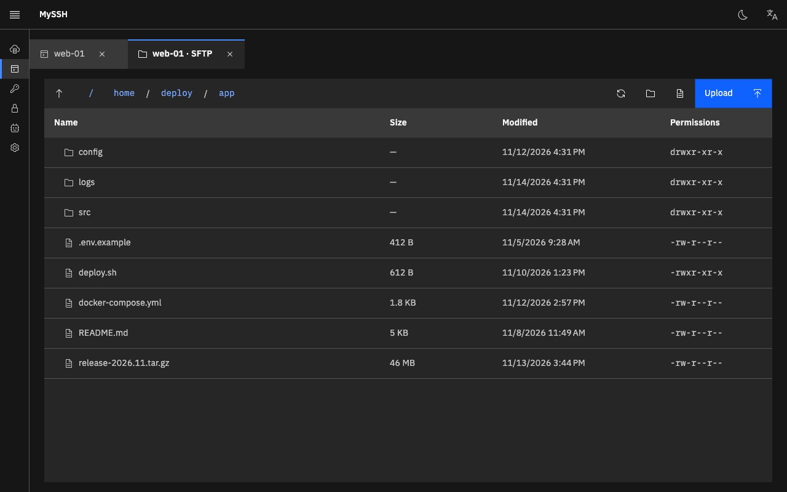
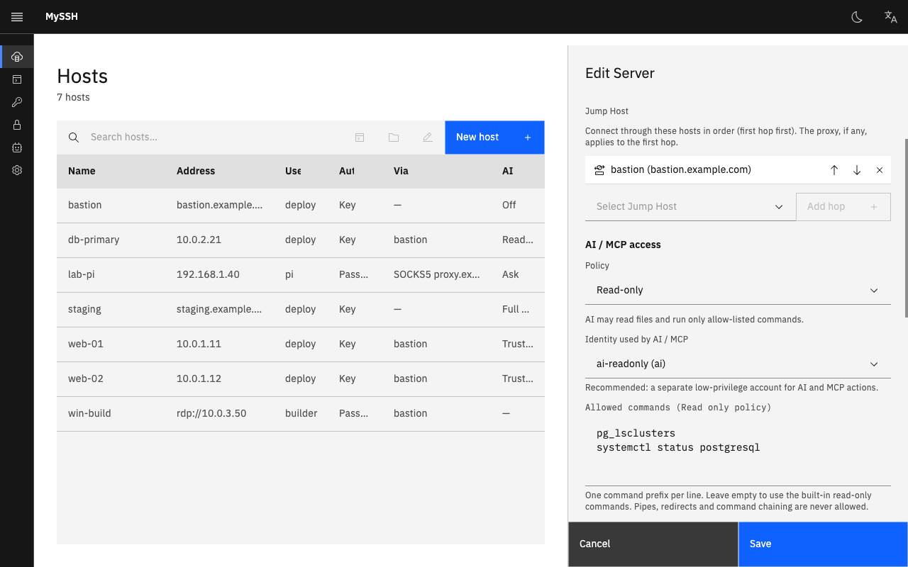

# MySSH

<p align="center">
  
</p>

<p align="center">
  A simple, open-source SSH client - Termius alternative
</p>

<p align="center">
  <a href="https://myssh.pages.dev">Website</a> · <a href="https://github.com/dollarkillerx/MySSH/releases/latest">Download</a>
</p>

<p align="center">
  <strong>English</strong> | <a href="./README.zh-CN.md">简体中文</a> | <a href="./README.ja-JP.md">日本語</a>
</p>

## Features

- **Host Management** - Hosts, reusable identities (password / private key), proxies, tags, search
- **SSH Terminal** - Native terminal (XTerm.NET engine), 256 colours / true colour, OSC 7 working directory
- **SFTP File Browser** - Browse, upload, download, edit remote files; **Open SFTP** from a terminal opens its current directory
- **Jump Hosts** - Multi-hop chains (ProxyJump), each hop with its own identity, plus HTTP / SOCKS5 proxies
- **Windows Remote Desktop** - RDP hosts open in the system client (mstsc, Windows App, Remmina / FreeRDP), optionally tunnelled through an SSH jump host; the password is never written to the `.rdp` file
- **MCP Server** - Let Claude Code, Claude Desktop and other MCP clients run commands, read terminals and use SFTP on your hosts
- **AI Assistant** - Built-in chat panel (Claude, OpenAI, DeepSeek or a local OpenAI-compatible server): investigates with the same tools and per-host policy as MCP, approvals on inline cards, Ctrl+I command suggestions in the terminal, secrets masked before sending
- **Per-host AI Policy** - Off / Read-only / Ask / Trusted / Full access; high-risk commands (`rm -rf`, `systemctl stop`, ...) ask for approval, every call is audited
- **Secure Storage** - SQLite with AES-256-GCM field encryption; master key in the OS keystore or behind an Argon2id master password
- **Backup & Restore** - Password-protected export / import; imports hosts from the previous (Tauri) version
- **Multi-language** - English, Chinese (Simplified), Japanese
- **Cross-platform** - macOS, Windows, Linux

## Screenshots

| | |
|---|---|
|  |  |
| Hosts, jump hosts, proxies and per-host AI policy | Native terminal |
|  |  |
| SFTP, opened from the terminal's directory | Windows remote desktop through an SSH tunnel |
|  |  |
| Jump chain and AI / MCP access per host | MCP server for Claude Code / Claude Desktop |


<sub>High-risk commands from an AI client wait for your approval. Screenshots use demo data; regenerate them with
`MYSSH_README_SCREENSHOTS=1 dotnet test tests/MySSH.Desktop.Tests -- --filter-class MySSH.Desktop.Tests.ReadmeScreenshots`.</sub>

## MCP (AI clients)

1. Open **AI / MCP** and switch the MCP server on. It listens on `127.0.0.1` and a local socket only, with a bearer token.
2. Set an **AI / MCP policy** on each host you want to share (hosts are hidden from AI until you do).
3. Connect a client:
   - **Claude Code**: copy the `claude mcp add ...` command shown on the page.
   - **Claude Desktop**: copy the JSON snippet; it runs the bundled `myssh-mcp` bridge, which starts MySSH in the tray if needed.

Tools: `list_hosts`, `run_command`, `list_sessions`, `read_terminal`, `send_to_terminal`, `sftp_list`, `sftp_stat`, `sftp_read`,
`sftp_write`, `sftp_mkdir`, `sftp_delete`. Every call is recorded in the audit log.

## Installation

### Download

From [Releases](https://github.com/dollarkillerx/MySSH/releases/latest) or the [website](https://myssh.pages.dev):

- **macOS** (Apple silicon, macOS 13+): `MySSH-osx-Portable.zip` — unzip and move MySSH.app to Applications. Signed and notarized.
- **Windows** (x64, Windows 10+): `MySSH-win-Setup.exe`, or `MySSH-win-Portable.zip`. Not code-signed yet: if SmartScreen appears, choose **More info → Run anyway**.
- **Linux**: build from source for now.

Both packages update themselves (Settings → Updates). Releases up to v0.0.4 are the previous Tauri/Vue/Rust version (tag [`tauri-final`](https://github.com/dollarkillerx/MySSH/tree/tauri-final)).

### Build from Source

Prerequisites: [.NET SDK 10.0.404+](https://dotnet.microsoft.com/download/dotnet/10.0) (older 10.0 SDKs build, but bundle a NativeAOT compiler with a known vulnerability — don't publish with them).

```bash
git clone https://github.com/dollarkillerx/MySSH.git
cd MySSH

dotnet build MySSH.slnx                  # build everything
dotnet test MySSH.slnx                   # run tests
dotnet run --project src/MySSH.Desktop   # start the app
dotnet publish src/MySSH.Desktop -c Release -r osx-arm64   # NativeAOT build (win-x64 / linux-x64 likewise)
```

On first start MySSH offers to import hosts from the previous (Tauri) version; the old files are only read.

## Tech Stack

- **UI**: Avalonia 12 + IBM Carbon Design System (MVVM: CommunityToolkit.Mvvm)
- **Terminal**: native Avalonia control on the XTerm.NET VT engine
- **SSH/SFTP**: SSH.NET
- **Storage**: SQLite, AES-256-GCM field encryption, master key in the OS keystore or behind an Argon2id master password
- **Integrations**: MCP server (ModelContextProtocol C# SDK: Streamable HTTP + local socket, `myssh-mcp` stdio bridge); built-in AI assistant (own Claude HTTP/SSE client + OpenAI SDK)

Design: [docs/design/avalonia-carbon-mcp.md](docs/design/avalonia-carbon-mcp.md)

## License

MySSH is free software: you can redistribute it and/or modify it under the terms of the GNU Affero General Public
License as published by the Free Software Foundation, either version 3 of the License, or (at your option) any later
version (`AGPL-3.0-or-later`). See [LICENSE](LICENSE).

Releases up to v0.2.3 keep the license they were published under.
