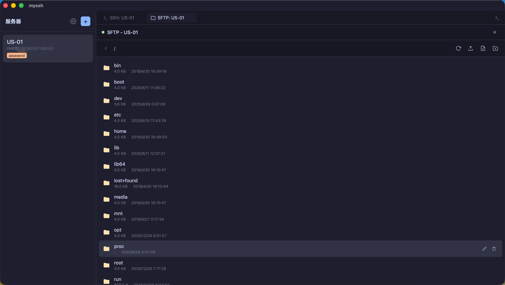
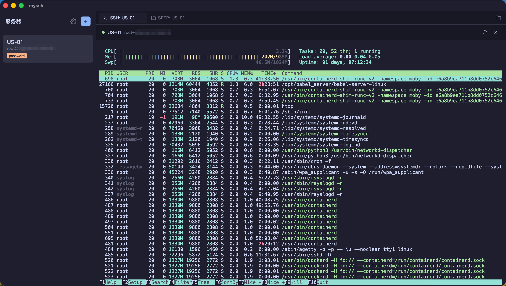

# MySSH

<p align="center">
  
</p>

<p align="center">
  A simple, open-source SSH client - Termius alternative
</p>

> **Rewrite in progress.** MySSH is being rebuilt on .NET 10 + Avalonia (IBM Carbon UI, native terminal, MCP server and a built-in AI assistant).
> The last Tauri/Vue/Rust version is tagged [`tauri-final`](https://github.com/dollarkillerx/MySSH/tree/tauri-final); releases up to v0.0.4 are that version.
> Design: [docs/design/avalonia-carbon-mcp.md](docs/design/avalonia-carbon-mcp.md).

<p align="center">
  <strong>English</strong> | <a href="#中文">中文</a> | <a href="#日本語">日本語</a>
</p>

## Features

- **Server Management** - Add, edit, delete SSH server configurations
- **SSH Terminal** - Full-featured native terminal (XTerm.NET engine)
- **SFTP File Browser** - Browse, upload, download, edit remote files
- **Authentication** - Password and private key authentication
- **Proxy Support** - HTTP and SOCKS5 proxy connections
- **Secure Storage** - AES-256-GCM encrypted credential storage
- **Backup & Restore** - Export/import configurations with password protection
- **Multi-language** - English, Chinese (Simplified), Japanese
- **Cross-platform** - macOS, Windows, Linux

## Screenshots




## Installation

### Download

Download the latest release from [Releases](https://github.com/dollarkillerx/MySSH/releases).

### Build from Source

Prerequisites: [.NET SDK 10.0.404+](https://dotnet.microsoft.com/download/dotnet/10.0) (older 10.0 SDKs build, but bundle a NativeAOT compiler with a known vulnerability — don't publish with them).

```bash
git clone https://github.com/dollarkillerx/MySSH.git
cd MySSH

dotnet build MySSH.slnx                  # build everything
dotnet test MySSH.slnx                   # run tests
dotnet run --project src/MySSH.Desktop   # start the app
dotnet publish src/MySSH.Desktop -c Release -r osx-arm64   # NativeAOT build (win-x64 / linux-x64 likewise)
```

On first start MySSH offers to import hosts from the previous (Tauri) version; the old files are only read.

## Tech Stack

- **UI**: Avalonia 12 + IBM Carbon Design System (MVVM: CommunityToolkit.Mvvm)
- **Terminal**: native Avalonia control on the XTerm.NET VT engine
- **SSH/SFTP**: SSH.NET
- **Storage**: SQLite, AES-256-GCM field encryption, master key in the OS keystore or behind an Argon2id master password
- **Integrations**: MCP server (ModelContextProtocol C# SDK), AI assistant (Claude / OpenAI / DeepSeek / OpenAI-compatible)

## License

MIT License

---

<h2 id="中文">中文</h2>

一个简单的开源 SSH 客户端，Termius 替代品。

### 功能特性

- **服务器管理** - 添加、编辑、删除 SSH 服务器配置
- **SSH 终端** - 原生全功能终端（XTerm.NET 引擎）
- **SFTP 文件浏览器** - 浏览、上传、下载、编辑远程文件
- **认证方式** - 支持密码和私钥认证
- **代理支持** - HTTP 和 SOCKS5 代理连接
- **安全存储** - AES-256-GCM 加密存储凭据
- **备份恢复** - 支持密码保护的配置导入/导出
- **多语言** - 中文、英文、日文
- **跨平台** - macOS、Windows、Linux

> **正在重写**：MySSH 正在用 .NET 10 + Avalonia 重新实现（IBM Carbon 界面、原生终端、MCP 服务、内置 AI 助手）。旧的 Tauri 版见 tag `tauri-final`。

### 从源码构建

需要 [.NET SDK 10.0.404+](https://dotnet.microsoft.com/download/dotnet/10.0)。

```bash
git clone https://github.com/dollarkillerx/MySSH.git
cd MySSH
dotnet build MySSH.slnx
dotnet test MySSH.slnx
dotnet run --project src/MySSH.Desktop
```

首次启动时会提示从旧版（Tauri）导入主机，旧文件只会被读取。

---

<h2 id="日本語">日本語</h2>

シンプルなオープンソース SSH クライアント - Termius の代替品

### 機能

- **サーバー管理** - SSH サーバー設定の追加、編集、削除
- **SSH ターミナル** - ネイティブのフル機能ターミナル（XTerm.NET エンジン）
- **SFTP ファイルブラウザ** - リモートファイルの閲覧、アップロード、ダウンロード、編集
- **認証** - パスワードと秘密鍵認証
- **プロキシ対応** - HTTP と SOCKS5 プロキシ接続
- **安全なストレージ** - AES-256-GCM 暗号化による認証情報の保存
- **バックアップ** - パスワード保護付きの設定エクスポート/インポート
- **多言語対応** - 日本語、英語、中国語
- **クロスプラットフォーム** - macOS、Windows、Linux

> **書き直し中**：MySSH は .NET 10 + Avalonia で再実装しています（IBM Carbon UI、ネイティブターミナル、MCP サーバー、AI アシスタント）。旧 Tauri 版はタグ `tauri-final` を参照してください。

### ソースからビルド

[.NET SDK 10.0.404+](https://dotnet.microsoft.com/download/dotnet/10.0) が必要です。

```bash
git clone https://github.com/dollarkillerx/MySSH.git
cd MySSH
dotnet build MySSH.slnx
dotnet test MySSH.slnx
dotnet run --project src/MySSH.Desktop
```

初回起動時に旧バージョン（Tauri）からホストをインポートできます。旧ファイルは読み取るだけです。
