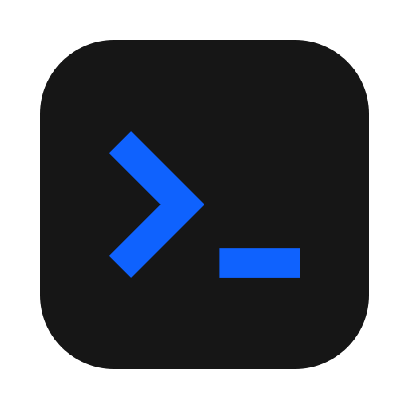
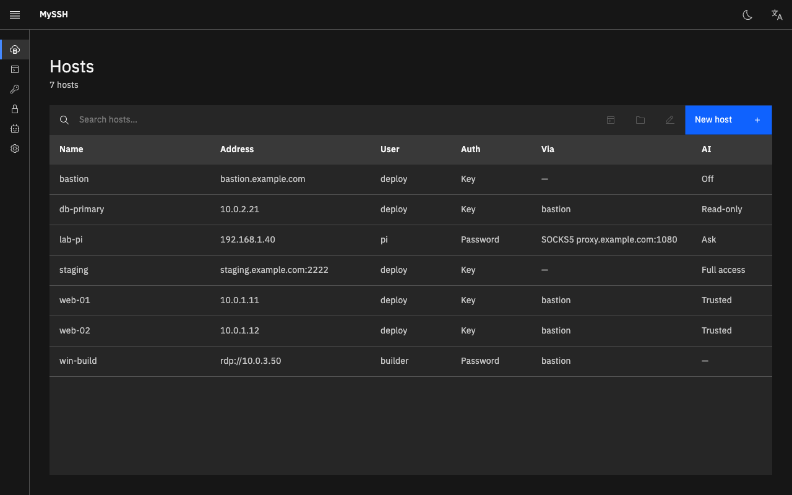
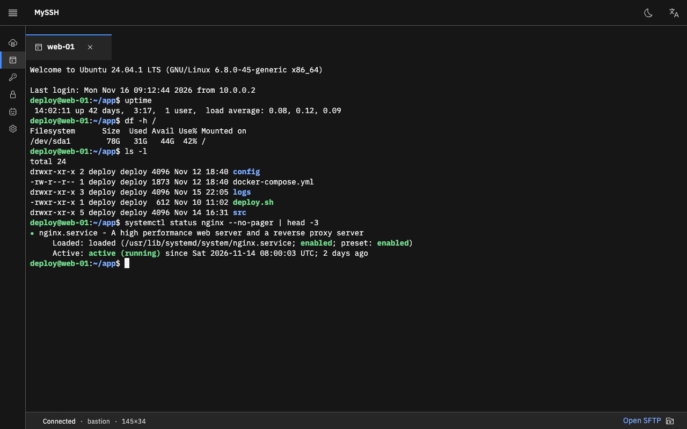
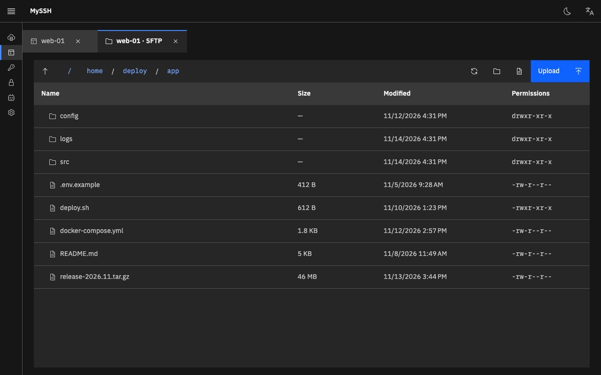
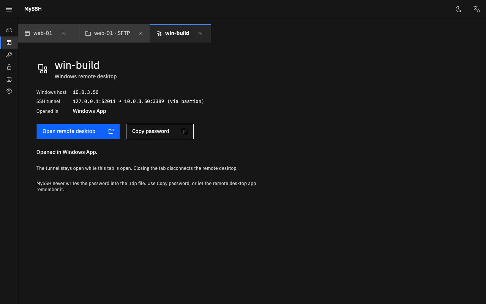
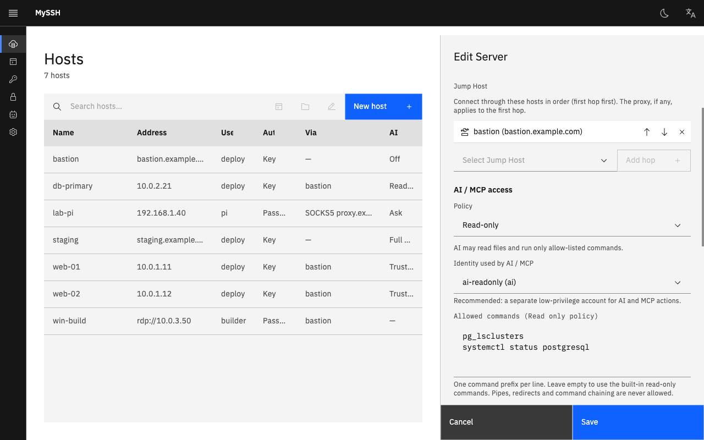
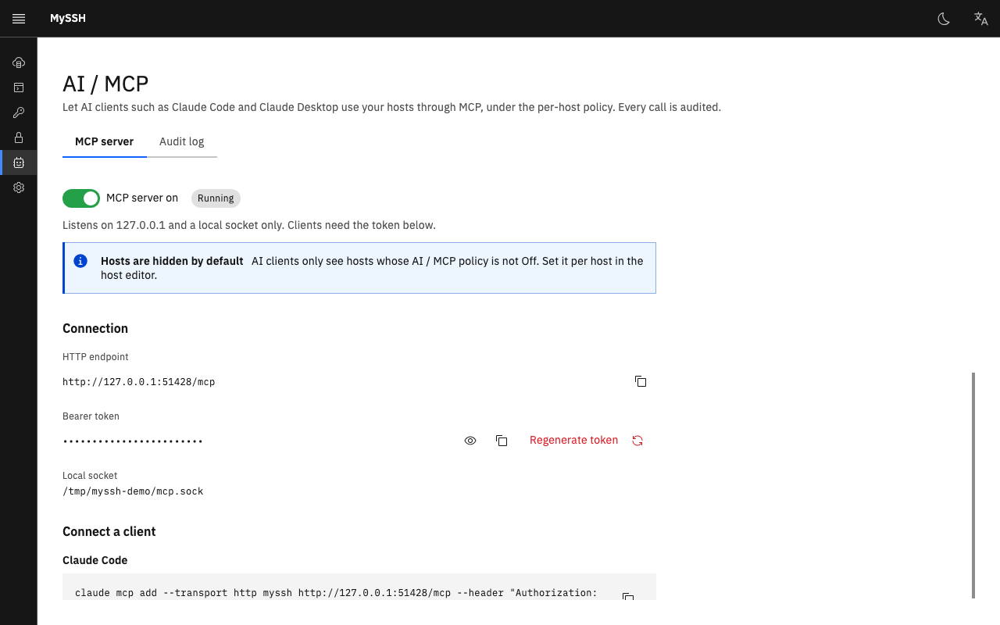
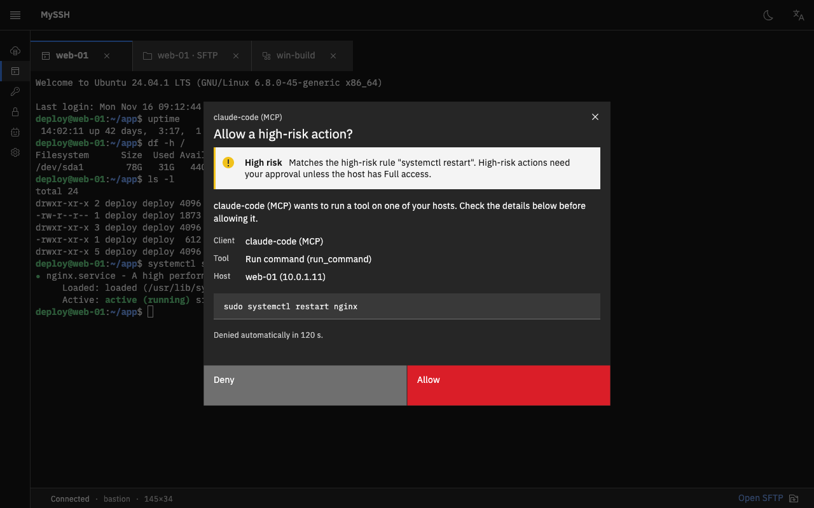

# MySSH

<p align="center">
  
</p>

<p align="center">
  一个简单的开源 SSH 客户端，Termius 替代品
</p>

> **正在重写**：MySSH 正在用 .NET 10 + Avalonia 重新实现（IBM Carbon 界面、原生终端、MCP 服务、内置 AI 助手）。
> 旧的 Tauri/Vue/Rust 版本见 tag [`tauri-final`](https://github.com/dollarkillerx/MySSH/tree/tauri-final)，v0.0.4 及之前的发布都是该版本。
> 设计文档：[docs/design/avalonia-carbon-mcp.md](docs/design/avalonia-carbon-mcp.md)。

<p align="center">
  <a href="./README.md">English</a> | <strong>简体中文</strong> | <a href="./README.ja-JP.md">日本語</a>
</p>

## 功能特性

- **主机管理** - 主机、可复用的身份（密码 / 私钥）、代理、标签、搜索
- **SSH 终端** - 原生终端（XTerm.NET 引擎），256 色 / 真彩色，识别 OSC 7 当前目录
- **SFTP 文件浏览器** - 浏览、上传、下载、编辑远程文件；在终端点 **打开 SFTP** 直接进入当前目录
- **跳板机** - 多跳链路（ProxyJump），每一跳使用自己的身份；支持 HTTP / SOCKS5 代理
- **Windows 远程桌面** - RDP 主机用系统远程桌面程序打开（mstsc、Windows App、Remmina / FreeRDP），可经 SSH 跳板机隧道；密码不会写入 `.rdp` 文件
- **MCP 服务** - 让 Claude Code、Claude Desktop 等 MCP 客户端在你的主机上执行命令、读取终端、使用 SFTP
- **AI 助手** - 内置对话面板（Claude、OpenAI、DeepSeek 或本地 OpenAI 兼容服务）：与 MCP 使用同一套工具和主机权限，审批直接在对话卡片上完成；终端里按 Ctrl+I 生成命令；发送前自动遮盖敏感信息
- **按主机的 AI 权限** - 关闭 / 只读 / 询问 / 信任 / 完全授权；高危命令（`rm -rf`、`systemctl stop` 等）需要你批准，所有调用都有审计日志
- **安全存储** - SQLite + AES-256-GCM 字段加密；主密钥存于系统钥匙串或由 Argon2id 主密码保护
- **备份恢复** - 支持密码保护的导出 / 导入；可从旧版（Tauri）导入主机
- **多语言** - 中文、英文、日文
- **跨平台** - macOS、Windows、Linux

## 截图

| | |
|---|---|
|  |  |
| 主机、跳板机、代理和按主机的 AI 权限 | 原生终端 |
|  |  |
| 从终端当前目录打开 SFTP | 经 SSH 隧道的 Windows 远程桌面 |
|  |  |
| 每台主机的跳板链和 AI / MCP 权限 | 供 Claude Code / Claude Desktop 使用的 MCP 服务 |



<sub>AI 客户端发起的高危命令会等待你的批准。截图使用演示数据（界面为英文），重新生成：
`MYSSH_README_SCREENSHOTS=1 dotnet test tests/MySSH.Desktop.Tests -- --filter-class MySSH.Desktop.Tests.ReadmeScreenshots`。</sub>

## MCP（AI 客户端）

1. 打开 **AI / MCP** 页面，开启 MCP 服务（只监听 `127.0.0.1` 和本地 socket，需要 Bearer Token）。
2. 在要开放的主机上设置 **AI / MCP 权限**（未设置的主机对 AI 不可见）。
3. 连接客户端：**Claude Code** 复制页面上的 `claude mcp add ...` 命令；**Claude Desktop** 复制 JSON 配置，它会运行随附的 `myssh-mcp` 桥接程序，必要时自动在托盘启动 MySSH。

工具：`list_hosts`、`run_command`、`list_sessions`、`read_terminal`、`send_to_terminal`、`sftp_list`、`sftp_stat`、`sftp_read`、`sftp_write`、`sftp_mkdir`、`sftp_delete`。每次调用都会记录到审计日志。

## 安装

### 下载

从 [Releases](https://github.com/dollarkillerx/MySSH/releases) 下载最新版本。

### 从源码构建

需要 [.NET SDK 10.0.404+](https://dotnet.microsoft.com/download/dotnet/10.0)。

```bash
git clone https://github.com/dollarkillerx/MySSH.git
cd MySSH
dotnet build MySSH.slnx
dotnet test MySSH.slnx
dotnet run --project src/MySSH.Desktop
```

首次启动时会提示从旧版（Tauri）导入主机，旧文件只会被读取。

## 技术栈

- **界面**：Avalonia 12 + IBM Carbon 设计系统（MVVM：CommunityToolkit.Mvvm）
- **终端**：基于 XTerm.NET VT 引擎的原生 Avalonia 控件
- **SSH/SFTP**：SSH.NET
- **存储**：SQLite、AES-256-GCM 字段加密，主密钥存于系统钥匙串或由 Argon2id 主密码保护
- **集成**：MCP 服务（ModelContextProtocol C# SDK：Streamable HTTP + 本地 socket，`myssh-mcp` stdio 桥接）；内置 AI 助手（自研 Claude HTTP/SSE 客户端 + OpenAI SDK）

## 许可证

MIT License
