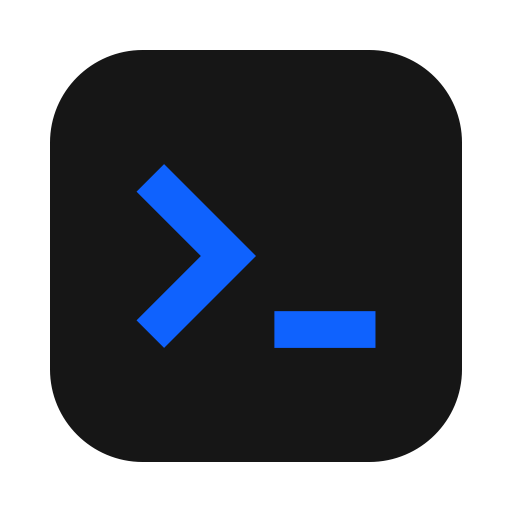
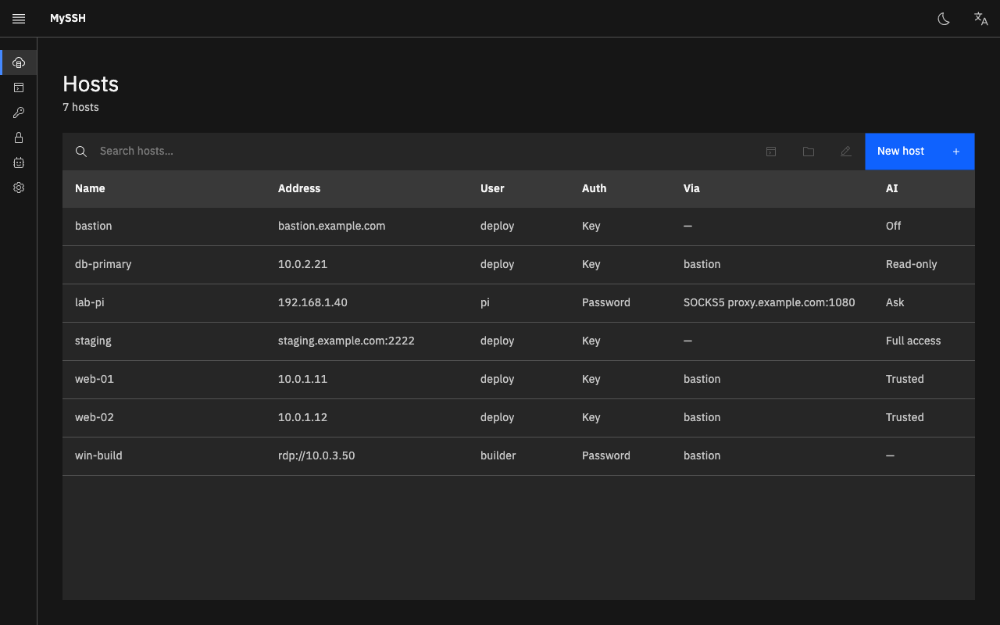
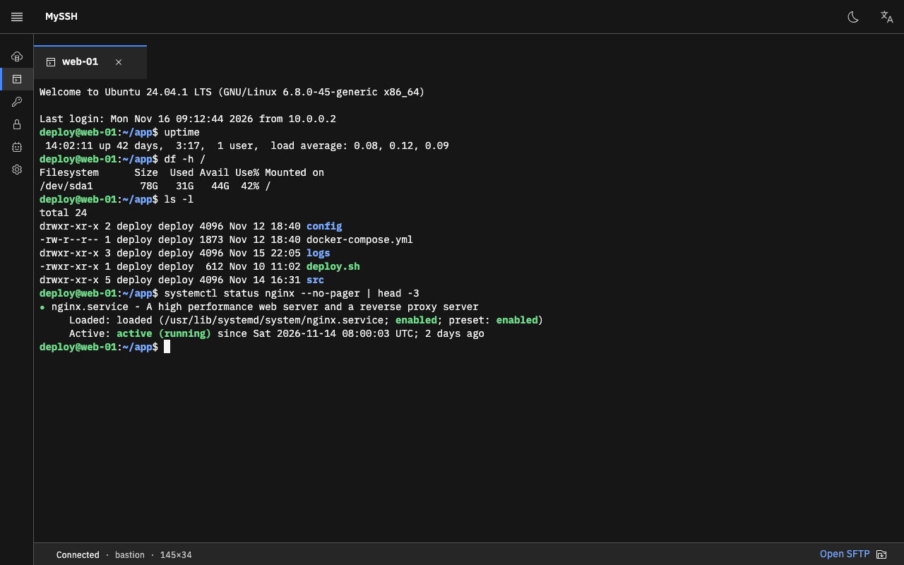
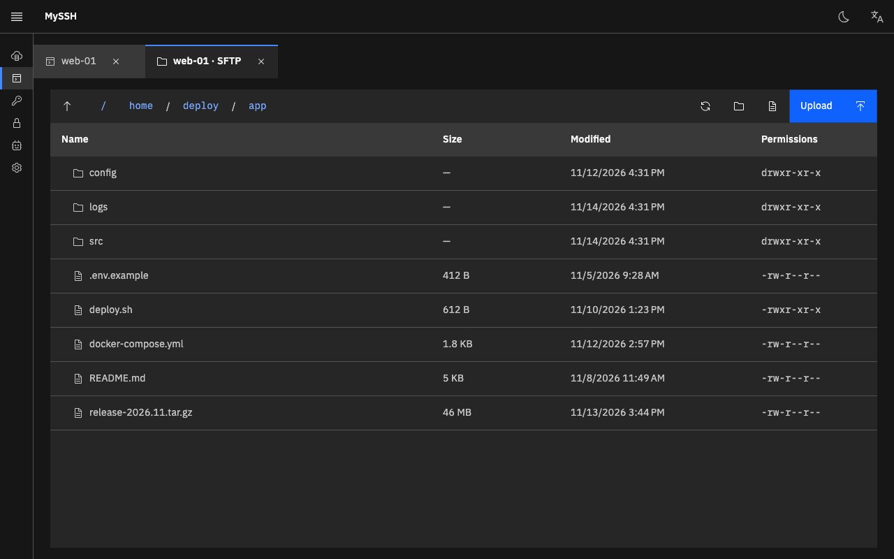
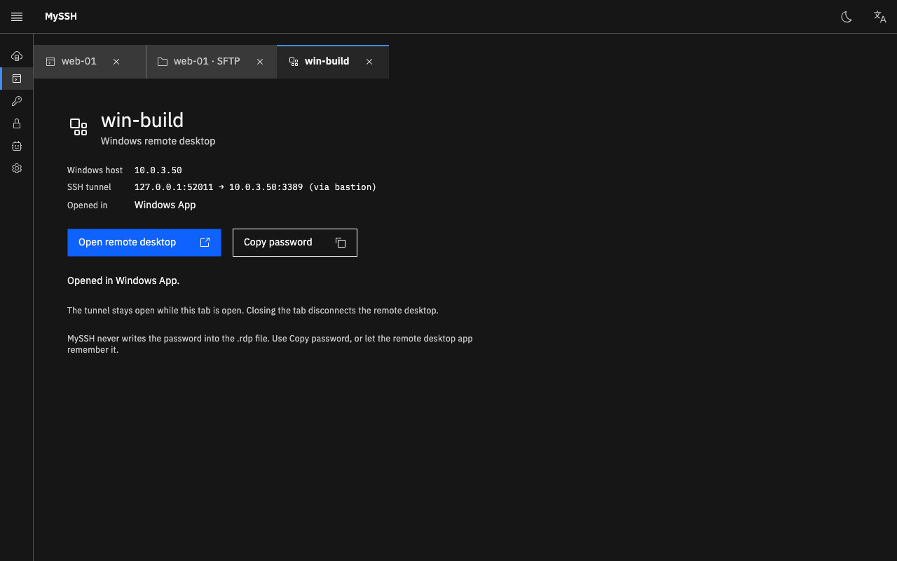
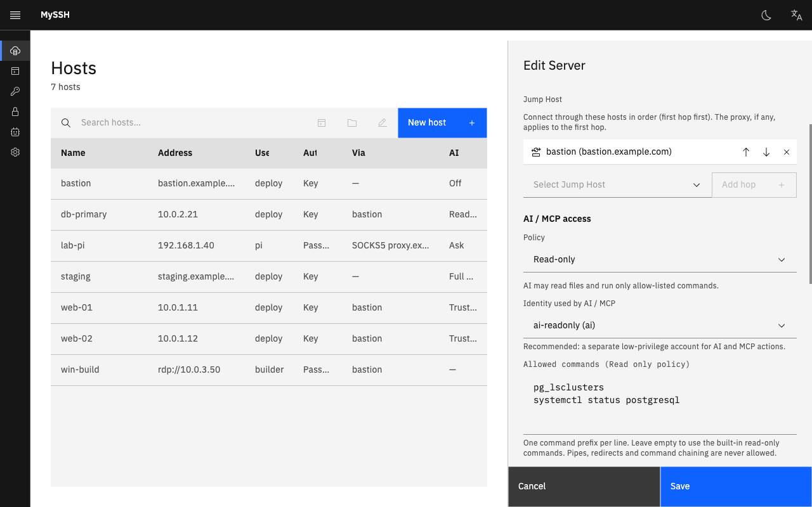
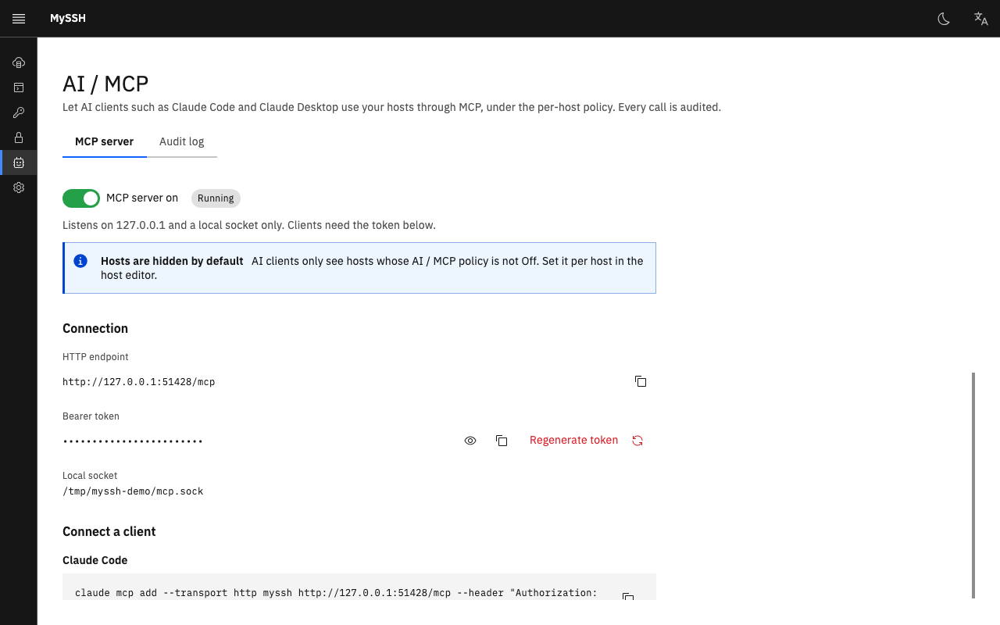
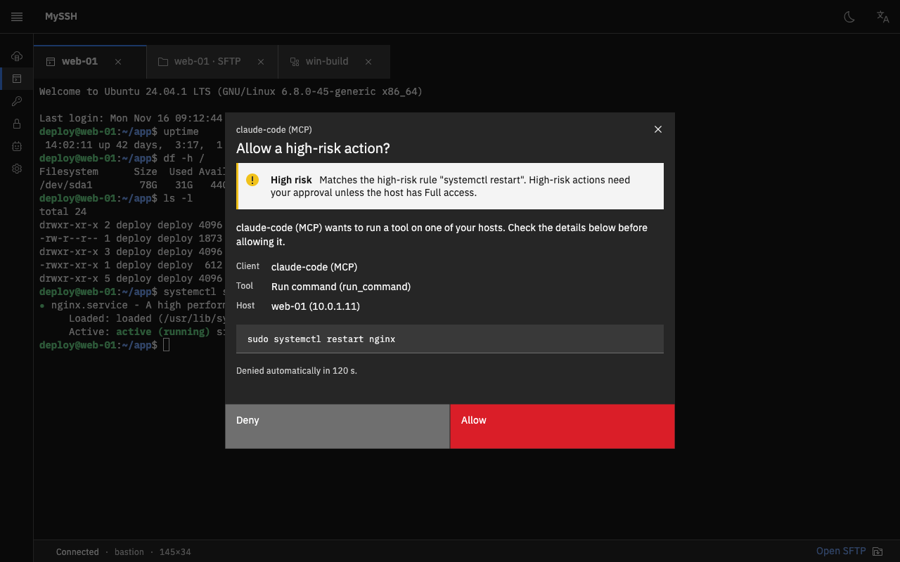

# MySSH

<p align="center">
  
</p>

<p align="center">
  一個簡單的開源 SSH 客戶端，Termius 替代品
</p>

<p align="center">
  <a href="https://myssh.pages.dev/zh-tw/">官網</a> · <a href="https://github.com/dollarkillerx/MySSH/releases/latest">下載</a>
</p>

<p align="center">
  <a href="./README.md">English</a> | <a href="./README.zh-CN.md">简体中文</a> | <strong>繁體中文</strong> | <a href="./README.ja-JP.md">日本語</a> | <a href="./README.ko-KR.md">한국어</a>
</p>

## 功能特性

- **主機管理** - 主機、可複用的身份（密碼 / 私鑰）、代理、標籤、搜尋
- **SSH 終端** - 原生終端（XTerm.NET 引擎），256 色 / 真彩色，識別 OSC 7 目前目錄
- **SFTP 檔案瀏覽器** - 瀏覽、上傳、下載、編輯遠端檔案；在終端點 **開啟 SFTP** 直接進入目前目錄
- **跳板機** - 多跳鏈路（ProxyJump），每一跳使用自己的身份；支援 HTTP / SOCKS5 代理
- **Windows 遠端桌面** - RDP 主機用系統遠端桌面程式開啟（mstsc、Windows App、Remmina / FreeRDP），可經 SSH 跳板機隧道；密碼不會寫入 `.rdp` 檔案
- **MCP 服務** - 讓 Claude Code、Claude Desktop 等 MCP 客戶端在你的主機上執行指令、讀取終端、使用 SFTP
- **AI 助手** - 內建對話面板（Claude、OpenAI、DeepSeek 或本地 OpenAI 相容服務）：與 MCP 使用同一套工具和主機權限，核准直接在對話卡片上完成；終端裡按 Ctrl+I 生成指令；傳送前自動遮蓋敏感資訊
- **按主機的 AI 權限** - 關閉 / 唯讀 / 詢問 / 信任 / 完全授權；高危指令（`rm -rf`、`systemctl stop` 等）需要你批准，所有呼叫都有稽核記錄
- **安全儲存** - SQLite + AES-256-GCM 欄位加密；主金鑰存於系統鑰匙圈或由 Argon2id 主密碼保護
- **備份恢復** - 支援密碼保護的匯出 / 匯入；可從舊版（Tauri）匯入主機
- **多語言** - 英文、簡體中文、繁體中文、日文、韓文
- **跨平台** - macOS、Windows、Linux

## 截圖

| | |
|---|---|
|  |  |
| 主機、跳板機、代理和按主機的 AI 權限 | 原生終端 |
|  |  |
| 從終端目前目錄開啟 SFTP | 經 SSH 隧道的 Windows 遠端桌面 |
|  |  |
| 每臺主機的跳板鏈和 AI / MCP 權限 | 供 Claude Code / Claude Desktop 使用的 MCP 服務 |



<sub>AI 客戶端發起的高危指令會等待你的批准。截圖使用演示資料（介面為英文），重新生成：
`MYSSH_README_SCREENSHOTS=1 dotnet test tests/MySSH.Desktop.Tests -- --filter-class MySSH.Desktop.Tests.ReadmeScreenshots`。</sub>

## MCP（AI 客戶端）

1. 開啟 **AI / MCP** 頁面，開啟 MCP 服務（只監聽 `127.0.0.1` 和本地 socket，需要 Bearer Token）。
2. 在要開放的主機上設定 **AI / MCP 權限**（未設定的主機對 AI 不可見）。
3. 連線客戶端：**Claude Code** 複製頁面上的 `claude mcp add ...` 指令；**Claude Desktop** 複製 JSON 配置，它會執行隨附的 `myssh-mcp` 橋接程式，必要時自動在托盤啟動 MySSH。

工具：`list_hosts`、`run_command`、`list_sessions`、`read_terminal`、`send_to_terminal`、`sftp_list`、`sftp_stat`、`sftp_read`、`sftp_write`、`sftp_mkdir`、`sftp_delete`。每次呼叫都會記錄到稽核記錄。

## 安裝

### 下載

從 [Releases](https://github.com/dollarkillerx/MySSH/releases/latest) 或[官網](https://myssh.pages.dev/zh-tw/)下載：

- **macOS**（Apple 晶片，macOS 13+）：`MySSH-osx-Portable.zip`，解壓後把 MySSH.app 拖到「應用程式」。已簽名並經過 Apple 公證。
- **Windows**（x64，Windows 10+）：`MySSH-win-Setup.exe`，或便攜版 `MySSH-win-Portable.zip`。暫未程式碼簽名，如果 SmartScreen 攔截，點「更多資訊 → 仍要執行」。
- **Linux**：目前請從原始碼構建。

安裝後會自動更新（設定 → 更新）。v0.0.4 及之前的發布是舊的 Tauri/Vue/Rust 版本（tag [`tauri-final`](https://github.com/dollarkillerx/MySSH/tree/tauri-final)）。

### 從原始碼構建

需要 [.NET SDK 10.0.404+](https://dotnet.microsoft.com/download/dotnet/10.0)。

```bash
git clone https://github.com/dollarkillerx/MySSH.git
cd MySSH
dotnet build MySSH.slnx
dotnet test MySSH.slnx
dotnet run --project src/MySSH.Desktop
```

首次啟動時會提示從舊版（Tauri）匯入主機，舊檔案只會被讀取。

## 技術棧

- **介面**：Avalonia 12 + IBM Carbon 設計系統（MVVM：CommunityToolkit.Mvvm）
- **終端**：基於 XTerm.NET VT 引擎的原生 Avalonia 控制元件
- **SSH/SFTP**：SSH.NET
- **儲存**：SQLite、AES-256-GCM 欄位加密，主金鑰存於系統鑰匙圈或由 Argon2id 主密碼保護
- **整合**：MCP 服務（ModelContextProtocol C# SDK：Streamable HTTP + 本地 socket，`myssh-mcp` stdio 橋接）；內建 AI 助手（自研 Claude HTTP/SSE 客戶端 + OpenAI SDK）

設計文件：[docs/design/avalonia-carbon-mcp.md](docs/design/avalonia-carbon-mcp.md)

## 授權條款

MySSH 是自由軟體，採用 GNU Affero 通用公共授權條款第 3 版或（由你選擇）任何更高版本（`AGPL-3.0-or-later`）發布，詳見 [LICENSE](LICENSE)。

v0.2.3 及之前的版本仍適用其發布時的授權條款。
